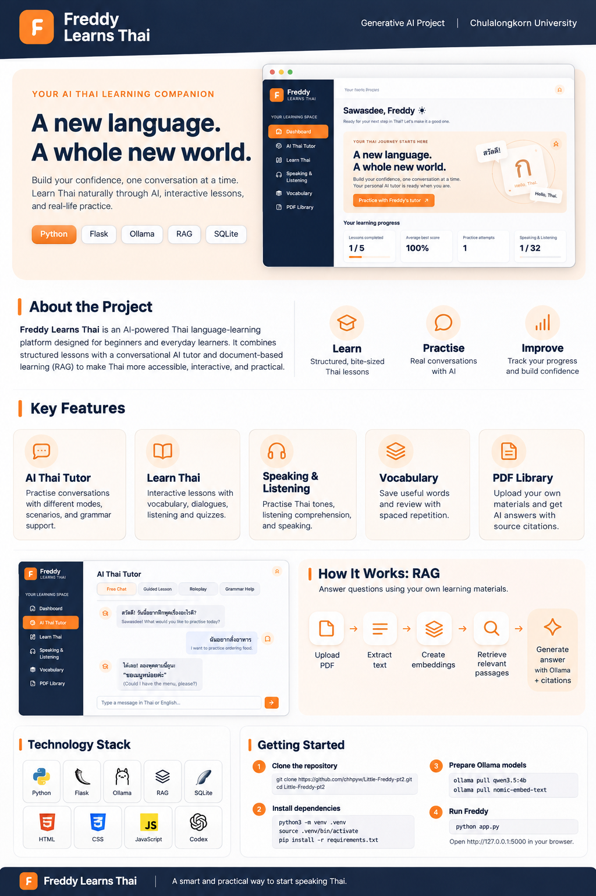

# Freddy Learns Thai

**A new language. A whole new world.**



*Branded project preview. Screens and progress values are illustrative; use the
installation and launch instructions below for current setup commands.*

**[Features](#features) · [Installation](#installation) · [Ollama & models](#ollama-and-models) · [Launch](#launch) · [Tests](#automated-tests) · [Troubleshooting](#manual-verification-and-troubleshooting)**

## About the project

A personal Thai learning workspace built with Flask, SQLite, HTML, CSS, and vanilla
JavaScript. It combines structured lessons, local Ollama conversation practice,
learning from uploaded documents, listening/speaking exercises, and spaced repetition.
The navy, orange, cream, and white interface adapts to desktop and mobile layouts.

## Features

- **Dashboard:** real lesson completion, best-score averages, attempts, speaking/
  listening completion, saved vocabulary, reviews due, mastery milestones, and
  self-rated recall accuracy. Recommendations use recorded mistakes and incomplete
  activities. Empty states do not invent study time or streaks.
- **AI Thai Tutor:** Beginner, Intermediate, and Advanced levels; Free Chat, Guided
  Lesson, Roleplay, and Grammar Help modes; pronunciation preference; session
  history; document/web source links. Failed requests keep drafts. The default
  Qwen3 model runs with [optional thinking](https://docs.ollama.com/capabilities/thinking) disabled to reduce latency.
- **Curriculum:** five complete A1 lessons covering greetings/introductions,
  numbers/prices, food/drinks, directions, and shopping. Each includes objectives,
  eight words, dialogues, sentence patterns, polite particles, translation toggle,
  listening controls, quizzes, and lesson-specific AI practice. Server-side scores
  of 75% complete a lesson. A2–B2 currently provide roadmaps and guided AI prompts,
  rather than complete scored courses.
- **PDF Library / RAG:** upload PDF, TXT, DOCX, and Markdown; text extraction,
  chunking, local embeddings, semantic/explicit-document retrieval, citations,
  viewing, and deletion. New uploads publish only after every chunk is embedded.
  Duplicate filenames return a conflict instead of replacing documents.
- **Speaking & Listening:** five tone guides with source-linked examples,
  romanization and illustrative pitch contours; sixteen listening and sixteen speaking
  activities; Thai browser TTS, replay/stop and optional slower playback; microphone
  transcription where supported. Feedback compares text, never tone or pronunciation
  accuracy. Browser recognition may use an online provider.
- **Vocabulary:** lesson imports and manual words, examples, six categories,
  flashcards, optional Thai audio, due-review sessions, SM-2 scheduling, review
  history, and duplicate/stale-review protection.

## Technology stack

Python 3.9+, Flask 3.1, SQLite via Python's standard library, Requests, NumPy,
pypdf, python-docx, and the Ollama HTTP API. The frontend uses plain JavaScript,
CSS, browser speech synthesis and optional speech recognition. There is no npm
build step or frontend framework. Node.js 18+ is only needed to run JavaScript tests.
Python tests use `unittest`; JavaScript tests use Node's built-in assertions and VM.

## Installation

From a terminal in this existing project:

```sh
cd /Users/poonyaweeliu/Freddy-Learns-Thai
python3 -m venv .venv
.venv/bin/python -m pip install -r requirements.txt
.venv/bin/python -m pip check
```

If `.venv` already contains the project's dependencies, reuse it. Requirements have
major-version bounds; the integration review used Flask 3.1.3, Requests 2.32.5,
NumPy 2.0.2, pypdf 6.21.4, and python-docx 1.2.0. A clean dependency installation
was not performed as part of that review.

## Ollama and models

Install Ollama and start its desktop app, or run `ollama serve` if a server is not
already listening on port 11434. Do not start a second server on the same port.

```sh
ollama pull qwen3.5:4b
ollama pull nomic-embed-text
ollama list
```

`qwen3.5:4b` is the default chat model. `CHAT_MODEL` overrides it with another installed
model, including `qwen3:1.7b`. `nomic-embed-text` provides embeddings. Core local
features do not require an API key or paid API. Lessons, scoring, vocabulary, and
progress work without Ollama; chat and new document embeddings require it.

Supported beginner teaching examples now come from the reviewed curriculum, with
fixed meanings, pronunciation guides and usage notes. Generated conversation is
separately labeled unreviewed. Review does not imply native verification; both
models can still produce inaccurate explanations. See the [semantic benchmark and
failed cases](docs/tutor-reliability-benchmark.md).

## Launch

```sh
cd /Users/poonyaweeliu/Freddy-Learns-Thai
.venv/bin/python app.py
```

Open **http://127.0.0.1:5000**. The server binds to loopback with debug disabled.
If port 5000 is occupied:

```sh
PORT=5055 .venv/bin/python app.py
```

Open **http://127.0.0.1:5055** for that command.

Configuration comes from process environment variables; `python app.py` does not
automatically load `.env` files.

| Variable | Default | Purpose |
| --- | --- | --- |
| `OLLAMA_URL` | `http://127.0.0.1:11434` | Ollama base URL |
| `CHAT_MODEL` | `qwen3.5:4b` | Installed chat model |
| `EMBED_MODEL` | `nomic-embed-text` | Installed embedding model |
| `OLLAMA_API_KEY` | Unset | Optional bearer credential for a compatible backend |
| `PORT` | `5000` | Flask port |
| `FREDDY_UPLOAD_FOLDER` | Project `uploads/` | Document directory; created on startup |
| `FREDDY_INDEX_FILE` | Project `vector_index.json` | JSON vector index |
| `FREDDY_PROGRESS_DATABASE` | Project `progress.sqlite3` | Shared learner database |

Custom index/database parent directories must exist and be writable. Keep custom
learner paths outside the repository, or extend `.gitignore` for them. Changing
embedding models requires re-indexing documents. Changing chat models does not.

Optional web search calls the configured backend's `/api/web_search` endpoint.
Availability depends on that backend; a normal local installation may not provide
it. An unavailable endpoint produces a warning and no web sources. Live web search
was not verified in the integration review. Never interpret absent web citations
as evidence that a web search succeeded.

## Learning data and safety

SQLite stores lesson best/latest scores and attempts, speaking/listening attempts,
saved vocabulary, SM-2 state, and review history. Additive migrations retain existing
records. Bangkok dates determine review eligibility; review history uses UTC
timestamps. Recall accuracy is self-reported, separate from quiz scoring. The
mastered count is a scheduling milestone, not a language proficiency assessment.

Before a backup, stop the Flask process, then copy `uploads/`, `vector_index.json`,
and `progress.sqlite3` to a safe location. Do not delete or reset them to troubleshoot.
`.gitignore` excludes environments, learner databases and sidecars, uploads, default
vector indexes, `.env` files, and common credential files. Ignore rules do not remove
files that were already committed; do not commit learner data or credentials.

Document writes are staged, the JSON index is atomically replaced, and in-process
writers are serialized. Failed new imports are cleaned up; older unindexed files
are preserved. A corrupt index returns a storage error rather than being overwritten.
This is a **single-process personal app**, not a public multiuser service. It has no
accounts/authentication. Keep it on loopback; do not expose it through a tunnel or
bind it publicly. Host validation, cross-origin mutation checks, safe filenames,
symlink rejection, security headers, and safe text rendering provide local defenses,
but are not a complete independent security audit.

### Re-indexing

Stop Flask first and back up the index. Run with the same model/path configuration:

```sh
.venv/bin/python reindex.py
```

The script updates only fully embedded documents and retains previous chunks when
extraction/embedding fails. Do not run it concurrently with Flask or another index
writer. For a corrupt index, preserve a backup and explicitly move the damaged index
aside before rebuilding; the application deliberately will not erase it for you.
Scanned/image-only PDFs need OCR externally before they can be indexed.

## Automated tests

```sh
.venv/bin/python -m unittest discover -s tests -v
node tests/navigation.test.js
node tests/app.test.js
node tests/speech.test.js
node tests/vocabulary.test.js
```

Python tests isolate storage and mock model calls. JavaScript suites exercise UI
handlers with fixtures and mocked browser APIs; they do not prove real microphone,
audible TTS, or responsive rendering. No npm install is needed. If `node` is missing,
install Node.js to run these optional frontend tests; Flask itself still runs.

Opt-in live verification uses synthetic prompts and a generated PDF in temporary
storage, without modifying your collection or learner database:

```sh
.venv/bin/python scripts/live_ollama_smoke.py --all-tutor-settings --report /tmp/freddy-live-results.json
```

This may take several minutes. A failed model-content check remains a failure even
if HTTP status is 200. See [integration results and limitations](docs/integration-review.md).

## Manual verification and troubleshooting

- **Cannot connect to Flask:** use the exact URL/port printed in the terminal. For
  “address already in use,” choose `PORT=5055` or stop your own earlier instance.
- **Ollama unavailable/timeout:** start Ollama, check `ollama list`, confirm both
  model names and `OLLAMA_URL`, and retry a short prompt. The default Qwen3 thinking
  path is disabled. Tutor replies now use structured fields and script validation,
  with one clean-history retry. Supported beginner contexts can show an explicitly
  labeled reviewed lesson fallback when AI commentary fails; other contexts return
  an error. Rejected replies are never saved, and drafts are kept for retry.
  Restart Flask after Python changes and refresh the browser. See the
  [usability diagnosis and live HTTP results](docs/tutor-usability-fix.md).
  Unicode checks do not establish linguistic accuracy.
  See [script safety and actual model results](docs/tutor-script-safety.md). A successful HTTP response
  does not validate teaching quality or the correctness of a translation.
- **PDF upload fails:** use a text-based PDF, an allowed extension, and a file under
  50 MB. Rename duplicate files. Check the embedding model and directory permissions.
  No incomplete new document is published. Do not delete originals to clear errors.
- **Missing retrieval/citations:** confirm the file was indexed. Explicitly mention
  its filename; semantic retrieval uses the top three chunks above the similarity
  threshold. Dimension changes require re-indexing. An embedding-service failure
  is disclosed; a reply without sources may be general model knowledge.
- **Database unavailable:** check that the configured parent directory exists and is
  writable. Preserve the database and SQLite sidecars. Storage errors return JSON
  guidance rather than exposing an exception or silently resetting progress.
- **No Thai audio:** install a Thai device speech voice and refresh voices. TTS rate
  support and quality vary. It is not a verified recording or acoustic assessment.
- **Microphone unavailable/denied:** use localhost/HTTPS, a supported browser, and a
  connected microphone; check site permission. Browser recognition may need internet.
  No transcript means no saved speaking attempt. Never assume Thai recognition works
  merely because the API constructor is present.
- **urllib3 LibreSSL warning:** the existing macOS Python environment emits this
  warning. Use a Python build linked against a supported OpenSSL version for HTTPS
  services; do not disable TLS verification. Local HTTP smoke tests still ran here.
- **Blank/stale UI:** check browser console errors, refresh the page, and retry. No
  frontend compilation is required. Tutor history uses session storage; lesson and
  review progress use SQLite. All browsers share this personal workspace's progress.

Detailed checklists: [speaking/audio](docs/speaking-listening-testing.md),
[vocabulary and SM-2](docs/vocabulary-spaced-repetition.md), and
[final integration/manual checklist](docs/integration-review.md).
